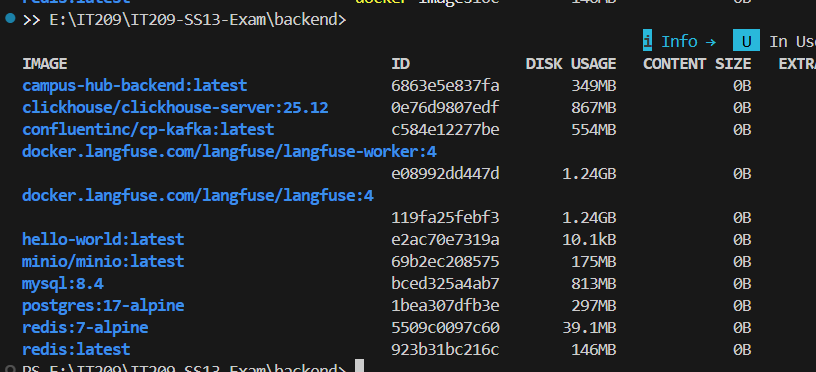
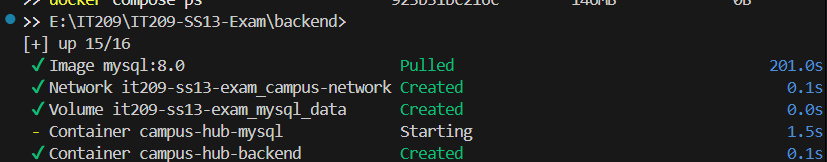

# Bài kiểm tra đầu giờ — Đóng gói và chạy Campus Hub với Docker

## Thông tin sinh viên
- **Họ và tên:** Bùi Đức Lợi
- **Mã sinh viên:** [Điền mã sinh viên của bạn tại đây]
- **Lớp:** CNTT2 - KS24
- **Repository:** https://github.com/LLL2006/HN-KS24-CNTT2-BuiDucLoi-IT209-SS13-Exam

---

## Hướng dẫn chạy hệ thống

### 1. Kiểm thử backend bằng Gradle
```bash
cd backend
./gradlew test
# Hoặc trên Windows:
./gradlew.bat test
```

### 2. Đóng gói backend thành Docker Image
```bash
# Đứng tại thư mục backend:
cd backend
docker build -t campus-hub-backend .
```
Kiểm tra image đã build thành công:
```bash
docker images
```

### 3. Khởi chạy hệ thống bằng Docker Compose (Backend + MySQL)
```bash
# Đứng tại thư mục gốc repository:
docker compose config
docker compose up -d
```
Kiểm tra trạng thái các service:
```bash
docker compose ps
```

### 4. Kiểm tra sức khỏe hệ thống (Health Check)
- **URL kiểm tra:** `http://localhost:8080/actuator/health`
- Lệnh kiểm tra qua terminal:
```bash
curl http://localhost:8080/actuator/health
```
- Kết quả trả về mong đợi: HTTP 200 `{"status":"UP"}`

---

## Minh chứng kết quả làm bài

### 1. Docker Image đã build thành công
> Chụp ảnh terminal hiển thị kết quả build thành công hoặc danh sách `docker images` chứa image `campus-hub-backend`.



---

### 2. Trạng thái các service sau khi chạy Compose
> Chụp ảnh terminal hiển thị kết quả lệnh `docker compose ps` với cả hai service `campus-hub-backend` và `campus-hub-mysql` đều ở trạng thái đang chạy (running / healthy).



---

### 3. Kết quả gọi `/actuator/health`
> Chụp ảnh gọi lệnh `curl http://localhost:8080/actuator/health` hoặc truy cập trình duyệt trả về `{"status":"UP"}`.


---

# Tài liệu gốc của Campus Hub Base

Campus Hub là dự án nền cho Mini Project Session 13. Ứng dụng cung cấp một không gian chung để sinh viên đăng sự kiện, tìm đồ thất lạc, hỏi đáp, trao đổi đồ dùng và tìm nhóm.

## Chức năng có sẵn
- Xem, tìm kiếm và lọc bài đăng.
- Đăng ký, đăng nhập bằng HTTP Basic.
- Tạo bài đăng theo chuyên mục.
- Bình luận và bày tỏ quan tâm.
- Chủ bài đăng có thể đánh dấu bài đã hoàn tất.
- Quản trị viên có quyền quản lý trạng thái bài đăng qua API.
- Health check tại `/actuator/health`.

Tài khoản mẫu được tạo khi ứng dụng khởi động lần đầu:

| Vai trò | Tên đăng nhập | Mật khẩu |
|---|---|---|
| Sinh viên | `student` | `student123` |
| Quản trị viên | `admin` | `admin123` |

## Kiến trúc

```text
React frontend
    │ /api
    ▼
Spring Boot monolith
    │ JDBC
    ▼
MySQL
```
